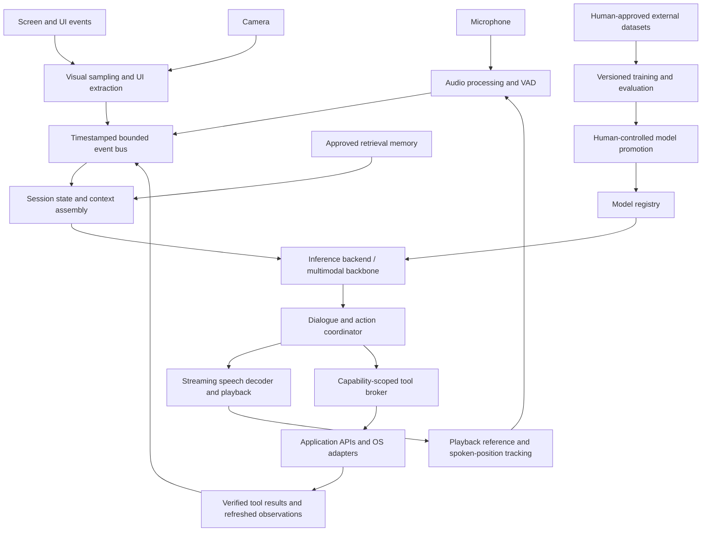

# Live multimodal assistant architecture

Status: proposed target architecture, not a list of completed capabilities.
The design builds on Sail's text/multimodal model experiments, capture abstractions,
streaming data pipeline and generation snapshots. It requires substantial new
runtime integration and learned capabilities.

## Foundational invariant

[ALIGNMENT.md](../ALIGNMENT.md) applies permanently: **no autonomous recursive
self-improvement, ever, with no exceptions**. The model cannot modify its source,
architecture, optimizer, training objectives, permissions, deployment or this rule.

Live observations update session state and retrieval memory. Weight updates use
human-approved external datasets in a human-defined pipeline. Runtime transcripts,
generated answers, tool actions and self-assessments do not automatically become
training records or rewards. The training process has no command channel from the
assistant model. Sensor data requires an explicit human dataset-ingestion workflow
before it can be used as an approved training source.

## Overall topology

The action/observation feedback loop is runtime task execution. It does not change
weights, training policy or implementation. There is no model-to-training edge.

## Host runtime and process boundaries

Deploy capture, playback, screen access and application integration in a native
Windows host service for the user's current setup. WSL can run ingestion and
offline preparation. Use the verified native Windows WGPU path for Sail GPU work;
other inference adapters must be separately tested on the RX 7800 XT.

Logical components:

| Component | Owns |
| --- | --- |
| Host/session service | Sessions, cancellation, lifecycle, configured capabilities |
| Capture service | Microphone, camera, selected windows, UI events |
| Perception workers | Streaming ASR, visual embeddings, OCR and optional tracking |
| Inference worker | Immutable model generation, per-session model state |
| Speech worker | Streaming synthesis, codec state, playback buffer |
| Tool broker | Validated calls, execution, timeouts, retries, result verification |
| Context/memory service | Recent observations, task state, retrieval and provenance |
| Training worker | Approved data, optimizer, checkpoints, fixed evaluation |
| Model registry | Versioned artifacts, compatibility metadata, promotion/rollback |

Start with one host process and isolated model/tool workers where failure or GPU
ownership warrants it. Avoid a distributed microservice deployment initially.
Use bounded asynchronous channels internally; local IPC across process boundaries;
shared-memory or reference-counted media buffers instead of repeatedly serializing
raw frames. A WebSocket event stream can serve the dashboard. WebRTC is an option
for a separately authorized remote client, not a prerequisite for local operation.

## Audio input and conversational timing

Capture at the hardware sample rate, normalize channel layout, then resample to the
selected encoder/codec's required rate. Every chunk carries a monotonic timestamp
and sample position. Audio callbacks only move buffers; they must not run model
inference, allocate large tensors or wait for tools.

The audio path requires acoustic echo cancellation using the exact speaker
playback reference, noise suppression, level handling, speech detection and
endpoint detection. Optional push-to-talk or wake activation is a human setting.
Speaker attribution can distinguish the user from other voices when needed.

A streaming recognizer emits revisable partial transcripts and stable segments.
Only stable interpretations should commit consequential tool actions. Keep original
audio references so tone, timing and nonverbal information can reach a native
audio-understanding model when the task needs them.

The dialogue coordinator owns explicit states such as idle, listening,
interpreting, speaking, awaiting a tool and interrupted. It continues listening
during playback. On an interruption it stops queued speech, cancels pending model
generation and cancellable tool work, and records exactly how much speech the user
heard. Unplayed output is not treated as completed conversation. Completed external
side effects cannot be erased by cancelling the speech stream.

## Screen and camera context

Use selected-window/display capture, application metadata and structured UI data.
For Windows, the proposed capture adapter uses
[Windows.Graphics.Capture](https://learn.microsoft.com/en-us/windows/uwp/audio-video-camera/screen-capture).
[UI Automation](https://learn.microsoft.com/en-us/windows/win32/winauto/uiauto-uiautomationoverview)
supplies control properties, text and supported actions where applications expose
them. Combine this with pixels/OCR for canvas content and applications without
useful accessibility data.

Sample according to changes and the active task rather than feeding every display
refresh to a language model. Initial configurable budgets: screen 0.5–2 frames/s,
camera 1–5 frames/s, with temporary bursts for selected regions. These are design
starting points, not measured hardware guarantees. Retain a small timestamped
history for temporal questions, and compress visual tokens to a configured budget.

Maintain frame IDs, source window/camera IDs, capture time, visible text, candidate
objects, bounds and coordinate transforms. Keep observation separate from inference:
"dialog box visible in frame X" is distinct from "likely caused by failed login."
Refresh the relevant region before acting on an old observation. Browser/OS actions
should prefer stable element IDs and APIs over screen coordinates; coordinate
actions require current bounds, display scale and window-origin checks.

Capture activity must be visible and limited to the human-configured sources.
Remote model adapters receive captured context only when that route is explicitly
enabled. Retention and deletion are configured by the user, independently of
training.

## Time alignment and context assembly

Every event includes protocol version, session ID, source ID, event ID, monotonic
time, validity interval, causal parent/task ID, and payload reference. Model output
and audio chunks additionally identify their model generation and response ID.

The context assembler selects relevant observations for the utterance time. A
phrase such as "explain this error" binds to the active window/error region at
that time, not an arbitrary most recent frame. It prioritizes stable user speech,
active task state, fresh visual regions, verified tool results and retrieved
documents under separate token budgets.

Use three forms of state:

1. Short-lived synchronized audio/video buffers.
2. Session/task memory: requests, verified observations, pending calls and committed
   outcomes, plus the model's bounded per-session recurrent/KV state.
3. Approved long-term retrieval: user preferences, documents and selected episodic
   records with source/time/retention metadata.

Retrieval does not change model weights. Do not assume recurrent state is an
unlimited, exact database. Reset model state across sessions where appropriate;
bound attention caches and reconstruct context from explicit task records.

## Learned model architecture

Two inference modes should implement the same runtime interfaces:

**Initial useful system:** pretrained streaming ASR + capable instruction/tool
model + visual perception + streaming neural TTS. Model workers can use external
local runtimes behind adapters while Sail owns orchestration and evaluation.

**Sail target:** timestamped text, acoustic and visual streams enter a shared
Mamba/attention/MoE backbone through learned encoders/projectors and temporal/type
embeddings. Visual resampling bounds patch-token count. Streaming masks preserve
causality while configurable audio lookahead trades latency against recognition.

Required outputs include a text head, structured tool/action output, turn/endpoint
signals and a learned speech-token generator. A streaming neural codec decoder
turns predicted acoustic tokens into PCM. Use a text/semantic planning stream and
a speech stream with controlled alignment, so pronunciation/prosody do not require
waiting for the complete answer. Separate input and output audio states support
simultaneous listening and speaking. Multiple acoustic codebooks may use a small
specialized decoder rather than putting every codec token through the entire main
backbone.

This direction has precedents: [Moshi](https://github.com/kyutai-labs/moshi) models
full-duplex speech with a streaming neural codec; [Qwen3-Omni](https://huggingface.co/Qwen/Qwen3-Omni-30B-A3B-Instruct)
combines multimodal understanding with streaming speech output. These are design
references, not models verified to fit or run in the current Sail WGPU backend.

Current `OmnimodalLm` has input projectors and text logits. It does not yet contain
this speech generator/codec decoder or demonstrate broad visual/audio reasoning.
The existing roughly 0.58M-parameter checkpoint is a training prototype, not a
pretrained general assistant. Rust/Burn implementation correctness does not supply
missing learned capability.

Pretrained GGUF/safetensors weights do not automatically load as `.sea`. Use a
backend adapter, or implement an architecture-accurate converter and verify its
outputs numerically. Quantization requires compatible kernels and artifact support;
it cannot be assumed from adding a configuration value.

## Tool execution

The model proposes typed calls; host code executes them. Each tool has a schema,
capability grant, timeout, cancellation policy, output-size budget and defined side
effects. Prefer file/browser/application APIs and argument-vector process calls.
Model-produced text is never executed as a shell command by default.

Calls carry a unique ID, task ID, validated arguments and relevant preconditions
(for example an observed frame/element or expected file version). The broker checks
the current user grant, executes once, verifies the result and returns structured
observations. Retry automatically only when the operation is idempotent or a
completion check establishes that the prior attempt did not take effect.

Use narrowly scoped standing grants for routine actions. Destructive, externally
visible or otherwise ungranted actions require explicit user authorization.
Retrieved documents, web pages, OCR, tool output and audio are data; embedded
instructions cannot change permissions or policy. The model cannot grant itself
access to Sail's implementation/training/deployment controls.

A successful process exit is insufficient for many tasks: re-read the edited file,
check the requested UI state, inspect structured API results or run the relevant
tests. Speak about verified completion, not merely an issued command. Tool results
enter context with provenance and freshness; they do not become automatic training
examples.

## Learning and evaluation

Use a separate, human-defined pipeline:

`approved external sources → provenance/dedup → fixed document-level splits →
versioned preprocessing → training → held-out evaluation → human promotion`

Train capabilities in stages: text instruction/tool competence, image grounding,
speech understanding, speech synthesis, then mixed streaming interaction. Begin
with pretrained encoders/backbone components where feasible; train adapters first,
then selected layers under a fixed configuration. A later joint model still needs
human-approved paired data and controlled optimization.

Data must include actual speech/transcripts, speech/text synthesis pairs, images
with grounded questions/answers, temporally aligned video/audio events, and tool
demonstrations with schemas and observable outcomes. Add interruption/overlap/noise
examples for dialogue. Keep record identity tied to content, not just class labels.
Store compressed media plus manifests/references instead of large JSON float arrays
for production-scale corpora. Match sample rates, color/feature normalization,
codec versions, prompts and target shifts between training and inference.

Use separately masked losses for text, recognition, grounded responses, acoustic
codebooks, tool structure/arguments and turn timing. Human-defined configurations
set loss weights, schedules and retention/replay mixtures. Padding and media input
positions are not ordinary target tokens. Training examples cannot include future
observations unavailable at the corresponding runtime decision point.

Evaluate independent text/code tasks, WER/CER and semantic recognition accuracy,
speech intelligibility and listening quality, grounded visual accuracy and temporal
questions, tool success/side effects, interruption behavior and latency. Shuffle or
remove modalities to check whether responses actually depend on their content.
Preserve old-task holdouts to detect regressions during context-dependent training.

## Hardware scheduling and deployment

On a single RX 7800 XT 16 GB, prioritize the foreground interaction. Keep capture,
audio processing, metadata and much of retrieval on CPU. Benchmark candidate ASR,
speech and visual workers independently before allocating the GPU budget. Keep
selected models warm, cap media resolution/context lengths and bound every queue.

The interactive model, perception workers, speech decoder, cache and allocator
headroom must all fit simultaneously. Raw weight-size estimates exclude runtime
buffers and activations. Do not assume all large multimodal models fit just because
their active MoE parameter count is small. Full-precision training and interactive
inference should not compete for an unrestricted shared GPU budget.

Run training during configured idle periods or on another device. Yield at bounded
training-step boundaries when conversation starts. Snapshot sessions pin compatible
model/tokenizer/codec versions. Promote a validated generation at an explicit
boundary; do not switch vocabulary or codec halfway through an utterance.

## Proposed latency objectives and acceptance tests

These are engineering targets to measure, not current benchmark results:

| Metric | Initial target |
| --- | --- |
| Capture chunks | 10–20 ms |
| Interrupt-to-playback-stop, p95 | ≤150 ms |
| No-tool end-of-turn to first audible response, p95 | ≤1.5 s |
| Speech synthesis real-time factor | <1, preferably <0.5 with headroom |
| Relevant screen context age during an active task | ≤1 s |
| Session/event/tool trace completeness | Every output linked to its causal inputs |

Measure component and end-to-end p50/p95/p99, first-token versus first-audio time,
audio underruns, dropped/stale frames, CPU/GPU use and allocation peaks. Slow tools
need separate completion-time metrics rather than being hidden in a voice-latency
average. An acknowledgment is not the completed substantive answer.

Integration scenarios: speak while the assistant speaks; cancel a pending action;
move/resize the relevant window before a click; change the error after observation;
lose camera or audio input; timeout a tool; publish a new model during an active
session; recover from a worker crash; verify that screen instructions cannot grant
new tools; verify that generated output never enters the training queue.

## Delivery order and mapping to Sail

1. Native host event bus, cancellation and real audio I/O. Replace fixed ASR and
   harmonic tones with functioning streaming adapters; pass an interrupted voice
   conversation end-to-end.
2. Timestamped screen/UI/camera capture and context selection. Answer questions
   grounded in fresh visible evidence, with source/frame IDs in internal traces.
3. Typed tool broker and verification. Complete a user-granted task from speech
   through application action to observed result.
4. Explicit memory, retrieval, resource scheduler and generation-pinned sessions.
5. Clean paired data, independent evaluation and smaller Sail adapter experiments.
6. Native speech-token output, codec decoding and full-duplex joint training.
7. Optimize measured bottlenecks and benchmark the complete system under real load.

`src/voice.rs` provides initial I/O abstractions; `src/model/multimodal.rs` provides
input-projector experiments; `src/engine` provides generation snapshots;
`src/tool.rs` provides a prototype tool interface. Add explicit runtime, perception,
dialogue, speech-codec, tool-broker and memory modules rather than putting all
behavior into the training loop. Existing data/checkpoint work supports the
separate learning plane. No source code implementation is performed by this design.
