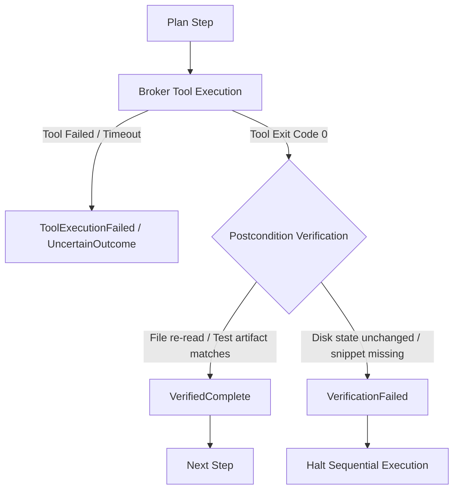

# Outcome Verification and Multi-Step Task Coordination

This document details the architecture, postcondition observation engine, dynamic revision handling, and honest status generation of the SAIL Outcome Verification system (`src/runtime/verification.rs`).

## 1. Motivation and Design Goals

A major flaw in naive autonomous agents is treating an API response with status 200 or an exit code 0 as definitive proof that the requested real-world outcome occurred. This causes severe failure modes:
1. **False Spoken Success**: An agent attempts an edit, receives an exit code 0 from a faulty or partially executing tool, and announces *"I fixed the error!"* even though the file on disk remains buggy or untouched.
2. **Obsolete Step Bleed**: When a user interrupts midway through a multi-step task with a correction (e.g. *"Stop, write to SQLite instead of JSON!"*), queued steps designed for the old objective must be cancelled immediately.
3. **Double Execution After Timeout**: Unconfirmed non-idempotent operations must be classified as `UncertainOutcome`, blocking blind retries without explicit user clarification or compensation.

---

## 2. Core Concepts

### 2.1 Independent Postcondition Observation (`StepPostcondition`)
Every step in a `TaskPlan` can declare independent postconditions that are inspected on the actual host system *after* tool execution:
- `FileContainsText { path, expected_snippet }`: Re-reads the file from disk using independent filesystem primitives to verify that the expected code change was committed.
- `FileExists { path }` / `FileDeleted { path }`: Verifies disk presence or absence.
- `TestPassed { test_name }`: Requires a successful `workspace_test_runner` artifact
  for the same requested test/filter, explicit integer counts with at least one
  passing test and zero failing tests, and exit code zero. Missing evidence or a
  zero-test run cannot satisfy the postcondition. This checks the artifact contract;
  the runner must still produce authentic, correctly parsed execution evidence.
- `UiElementMatches { element_id, expected_text }`: Inspects the active UI tree to confirm UI mutations.

> [!IMPORTANT]
> **Strict Verification Rule**:
> If a tool returns `BrokerExecutionStatus::Success` (exit code 0), but any declared postcondition fails upon independent observation, the step is marked `StepExecutionStatus::VerificationFailed`. The task **CANNOT** be marked complete.

### 2.2 Dynamic Task Revision & Cancellation of Obsolete Steps
- When the user interrupts with barge-in, `TaskPlan::revise_objective` updates `current_objective` and dynamically marks all unstarted `Pending` steps as `StepExecutionStatus::SkippedObsolete`.
- Obsolete steps never execute, preserving system resources and preventing unwanted mutations.

### 2.3 Honest Spoken Status Generation
Status messages generated for TTS output distinguish true verified outcomes from failures or unconfirmed states:
- **Verified Complete**: *"Task completed and verified: all N steps for '...' succeeded."*
- **Verification Failed**: *"Task failed postcondition verification: [reason]. Desired outcome was not observed on disk."*
- **Uncertain Outcome**: *"Task stopped with errors: N of M steps completed."*

---

## 3. Verification

The integration suite `tests/test_outcome_verification.rs` validates:
1. A tool claiming success while failing to commit disk changes produces `VerificationFailed` and rejects task completion.
2. User barge-in revisions cancel obsolete queued steps before execution.
3. Timeouts prevent false spoken success and block dangerous blind retries of non-idempotent actions.
4. End-to-end editor error and fix scenarios provide traceable verification connecting request, tool execution, disk observation, and spoken confirmation.

