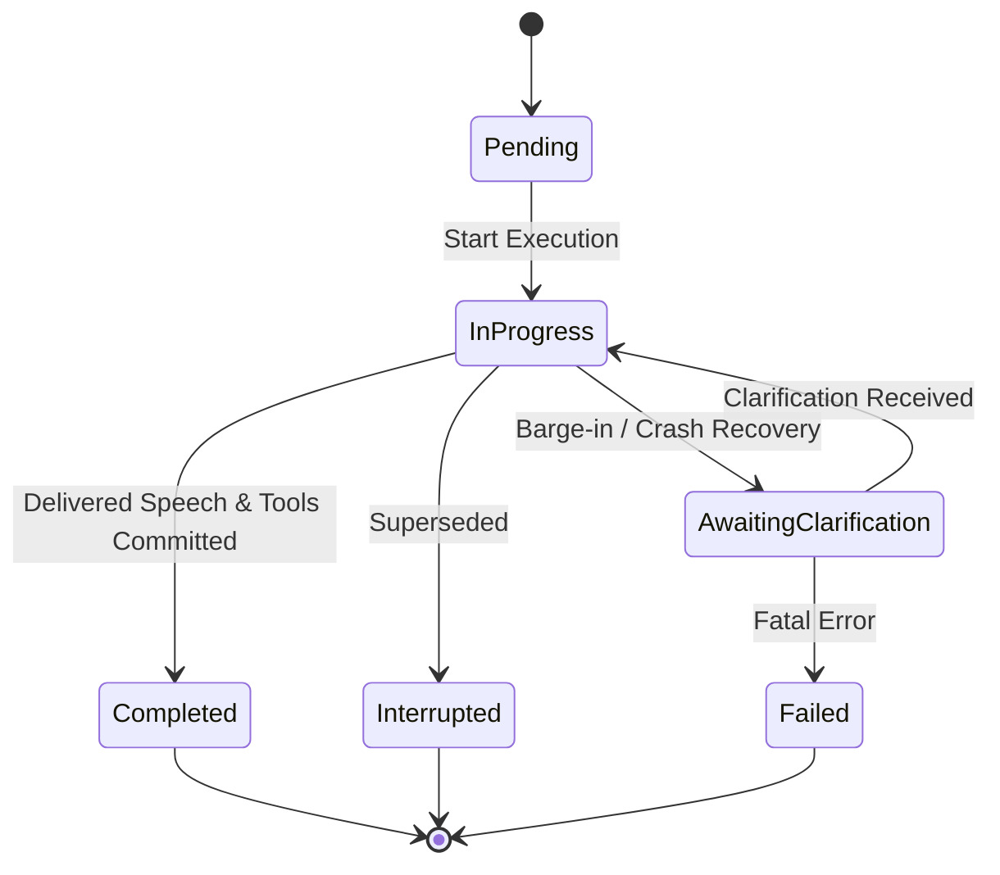

# Session and Task State Architecture

This document describes the host-owned explicit session and task state machine, bounded model memory tracking, and crash recovery mechanisms in SAIL.

## 1. Motivation & Design Principles

Pure autoregressive or state-space models operate over sequence tokens and internal recurrent activations. Relying solely on internal model activations or uncommitted context windows to determine task state causes critical failure modes:
1. **Silent re-execution**: In the event of an interruption or crash, the assistant might re-execute destructive tool side effects (e.g. database alterations, file deletions).
2. **Loss of distinction between completed vs abandoned speech**: If the user interrupts midway through a response, the host must know precisely what words reached the user's ears.
3. **Session bleed**: Multi-tenant or concurrent interaction sessions must have strict memory and state isolation.
4. **Crash recovery amnesia**: A worker restart must not blindly re-run unverified actions.

SAIL enforces **host-owned state**: the host runtime acts as the single source of truth for task objectives, delivered speech, tool execution records, and session lifecycle.

## 2. Task Lifecycle Status

Tasks transition through explicit lifecycle states:
- `Pending`: Registered but execution has not begun.
- `InProgress`: Actively generating responses, observing modalities, or orchestrating tools.
- `AwaitingClarification`: User interruption occurred or an in-flight tool encountered an uncertain outcome.
- `Completed`: Delivered final confirmed speech and all tool side effects recorded.
- `Interrupted`: Superseded by a new prompt or explicit user stop.
- `Failed`: Critical unrecoverable execution failure.

## 3. Crash Recovery and Tool Reconciliation

When a worker crash or process restart occurs:
- Completed tools with committed side effects remain `Completed`.
- In-flight tools with status `Running` are reconciled to `UncertainOutcome`. The model cannot assume whether the action committed, requiring explicit confirmation before any retry.
- Not-started tools are marked `Cancelled`.
- Volatile model caches (recurrent SSM state and KV cache) are cleared, while persistent host task history remains intact.

## 4. Multi-Session Isolation & Bounded Model Cache

- `SessionManager` manages concurrent sessions with isolated objectives, histories, and token usage budgets.
- Sessions enforce `max_tokens_retained` bounds on model context cache.
- Explicit session termination locks the session from further task creation and flushes volatile caches without mutating base model weights.

