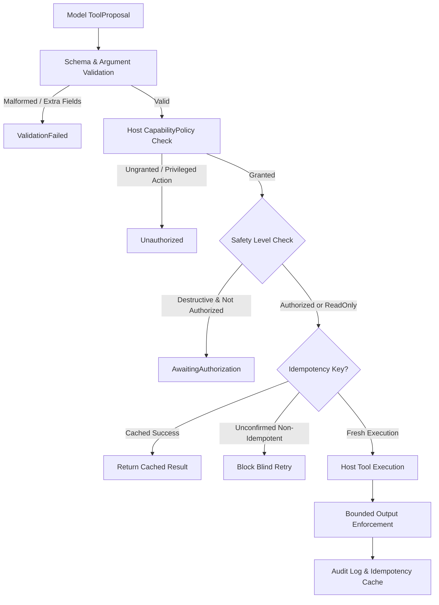

# Typed, Capability-Scoped Tool Execution Broker

This document describes the design, schema validation, safety gating, and idempotency guarantees of the SAIL Tool Execution Broker (`src/tool/broker.rs`, `src/tool/schema.rs`, and `src/tool/builtin.rs`).

## 1. Architectural Motivation

In standard language model architectures, tool invocation is often reduced to parsing arbitrary free-form strings or piping raw shell commands directly into system subprocesses. This introduces critical security and reliability vulnerabilities:
1. **Model-Generated Arbitrary Shell Commands**: Treating generated text as executable bash or cmd lines without argument schema validation is fundamentally unsafe.
2. **Missing Capability Boundaries**: A model should only be able to perform actions granted by the host operator through explicit capability tokens (`Capability::ToolExecution`).
3. **Double-Spend & Replay of Destructive Actions**: Non-idempotent actions (e.g. deleting files, committing financial transactions, sending external messages) must never be blindly repeated after network disconnects or timeouts.
4. **Autonomous Self-Improvement / Policy Evasion**: Tools must never be permitted to invoke privileged training pipelines, alter security policies, or modify `ALIGNMENT.md`.

---

## 2. Core Concepts

### 2.1 Versioned Tool Schemas (`ToolSchema`)
Every tool exposed to the assistant defines:
- **Version**: Semantic versioning (e.g. `1.0.0`).
- **Safety Level**:
  - `ReadOnly`: Non-mutating observation (e.g. `web_search`, `file_read`).
  - `ReversibleWrite`: Local, rollback-capable modification (e.g. draft buffer edits).
  - `DestructiveOrExternal`: Permanent file mutations, process spawns, or network modifications.
- **Strict Parameter Definitions**: Type checking (`String`, `Integer`, `Float`, `Boolean`, `Array`, `Object`), required fields, enum constraints, and rejection of unexpected extra fields when strict schemas are enabled.
- **Idempotency**: Explicitly marks whether repeated invocations with the same parameters yield identical state transitions.

### 2.2 Host Enforcement & Standing Authorizations
- **Separation of Proposal from Execution**: The model emits a `ToolProposal` (containing `call_id`, `task_id`, `tool_name`, `arguments`, `idempotency_key`). The host decides whether to authorize and execute it.
- **Destructive Gates**: Actions with `ToolSafetyLevel::DestructiveOrExternal` are paused with `BrokerExecutionStatus::AwaitingAuthorization` unless standing user authorization was granted (`grant_standing_authorization`) or interactive confirmation was confirmed (`interactive_confirmation_granted: true`).
- **Prompt Injection Defense**: Tool argument validation actively scans string parameters for prompt injection patterns (`ignore previous instructions`, `bypass alignment`, `<override_policy>`), preventing indirect injection from external data sources.

### 2.3 Idempotency and In-Flight Execution Safety
- **Identity-Bound Records**: Idempotency keys (`idempotency_key`) are bound to the proposing `task_id`, `tool_name`, `tool_version`, optional host `session_id`, and exact canonical argument JSON (`canonical_arguments: String`). Key reuse across different tasks, tools, tool versions, sessions, or arguments is strictly rejected with `BrokerExecutionStatus::ValidationFailed`.
- **Pre-Cache Revalidation**: Schema validation, host capability authorization, pre-execution cancellation token checks, and deadlines are evaluated before any cached result is returned. Revoking a capability immediately prevents delivery of previously cached results for that capability.
- **In-Flight Reservation & Concurrency Serialization**: Keys are reserved in an `IdempotencyRecordState::InFlight` state under a brief lock before tool execution begins. Concurrent duplicate calls observe the in-flight state and fail with `UnknownOutcome("Concurrent in-flight execution...")` rather than executing side effects twice. Global cache locks are never held during tool execution.
- **In-Flight Preservation & Capacity Bounds**: The cache enforces both record count (`MAX_IDEMPOTENCY_RECORDS = 1000`) and total raw output byte limits (`MAX_CACHED_OUTPUT_BYTES_TOTAL = 10MB`). In-flight records and unconfirmed non-idempotent unknown outcomes are **strictly non-evictable**. If cache capacity is exhausted and no completed records can be evicted, the broker fails closed with backpressure: `UnknownOutcome("Idempotency cache capacity exhausted: all active records are in-flight or protected")`.
- **Tool Version Promotion Invalidation**: Replacing a tool with a newer version immediately invalidates prior cached results for that tool; any attempt to reuse an existing idempotency key against the newer version returns `ValidationFailed`, preventing stale outputs from masquerading as new executions.
- **Retry Semantics**: If a non-idempotent operation times out (`BrokerExecutionStatus::UnknownOutcome`) or fails, blind retries are strictly blocked with:
  `"Cannot blindly retry non-idempotent action in UnknownOutcome status; requires explicit confirmation or compensation"`. Idempotent operations may retry after timeouts.
- **Session & Lifetime Contract**: Idempotency tracking is bounded to the in-memory host runtime session. Cross-process persistence across hard restarts is explicitly scoped for external SQLite storage and is not claimed by the in-memory broker.

### 2.4 Bounded Output Size Enforcement
Both freshly executed tool responses and cached deliveries are strictly clamped to `context.max_output_bytes`:
- Truncation slices only at valid UTF-8 character boundaries.
- Truncation reserves room for the notice `[Output truncated at N bytes]` when it fits within the limit; budgets smaller than the notice return the valid prefix up to the exact byte limit (including budgets 0 and 1).
- Cached deliveries record a correlated `ToolAuditRecord` with `from_cache: true`.

### 2.5 Monotonic Deadline Supervision and Dual Execution Contracts
The broker enforces distinct execution semantics for cooperative in-process tools and isolated external processes:
- **Cooperative In-Process Contract**: In-process tools (`TypedTool`) share the worker thread. Cooperative implementations poll `context.cancellation_token` and `context.deadline_ms` during work intervals (e.g. loops or chunks). If an arbitrary synchronous tool blocks without polling, the broker cannot preempt synchronous Rust execution; once the call completes, host elapsed monotonic time is measured against the deadline, and post-execution checks return `TimedOut` or `Cancelled`.
- **Isolated External Process Supervision**: Untrusted or heavy external processes (such as `WorkspaceTestRunnerTool`) run in an isolated process group (`cmd.process_group(0)` on Unix).
  - Standard output and standard error pipes are concurrently drained into bounded buffers (`max_capture_bytes`) on dedicated background threads, eliminating OS pipe deadlock risks where children block on unread 64KB buffers.
  - When cancellation or deadline triggers, the supervisor forcibly terminates the entire process group (`libc::kill(-pid, SIGKILL)` on Unix) and joins the stream reader threads.
  - Typed error prefixes (`CANCELLED:`, `TIMED_OUT:`) returned by supervised tools are preserved as exact `BrokerExecutionStatus::Cancelled` or `BrokerExecutionStatus::TimedOut`.
- **Monotonic Clock Calculations**: Deadlines are measured using host monotonic time (`Instant::now()`). Checked and saturating arithmetic prevents integer overflow across both duration budgets and absolute host timestamps.

---

## 3. Verification

The integration suite `tests/test_tool_execution_broker.rs` validates:
1. Rejection of malformed JSON, missing required fields, and unexpected extra fields.
2. Prompt injection detection and blocking.
3. Capability policy enforcement and prohibition of model-driven privileged actions.
4. Interactive authorization gates for destructive operations.
5. Idempotent result caching and prevention of blind retries for non-idempotent timed-out actions.
6. Cancellation tokens and bounded output truncation.

